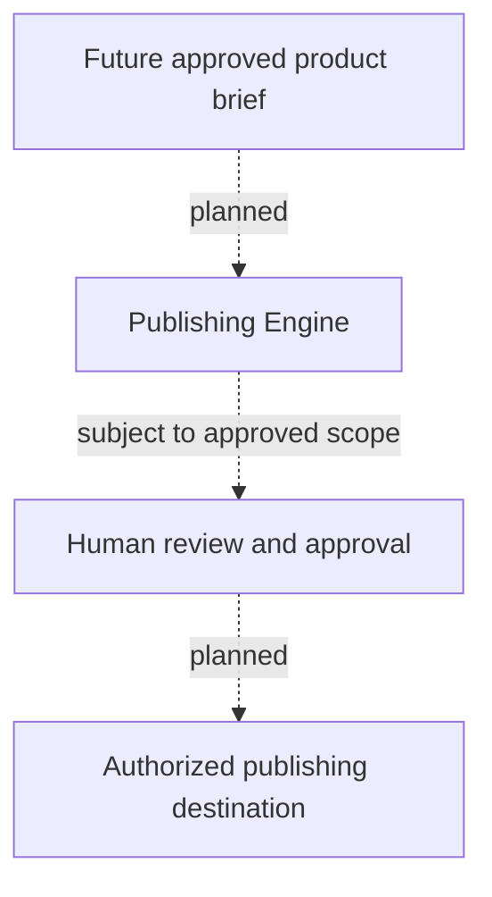

# Zubair Publishing Engine

[](#proof-of-concept--enterprise-customization-readiness)
[](#8-testing--verification)

**Zubair Publishing Engine is currently an empty repository reserved for a future publishing-related project.** The default branch contains only this README. No application source, product specification, dependency manifest, tests, workflow, or deployment configuration is present.

This document records the verified repository state. It does not imply that a publishing engine or automated publishing workflow has been implemented.

## 1. Project Overview & Problem Statement

The repository name indicates a possible future publishing-engine direction, but the repository currently contains no written product scope or technical requirements.

No supported claims can yet be made about:
- Supported publishing platforms or content formats.
- Content generation, editing, review, or approval capabilities.
- Scheduling, distribution, analytics, or account integrations.
- User interface, API, data storage, or automation behavior.

### Conceptual boundary only



The diagram is a placeholder for future requirements, not an architecture implemented in this repository.

## 2. Tech Stack & Versions

No programming language, runtime, framework, database, package manager, or dependency version is selected.

The current repository tree contains only `README.md`. Do not infer Python, Node.js, browser automation, AI models, or platform APIs from the repository name.

## 3. Prerequisites & Dependencies

No application prerequisites or runtime dependencies are currently defined.

To inspect the repository, Git is sufficient:
- Git
- Access to the GitHub repository

No paid API, subscription, hosting service, or external runtime is configured.

## 4. Installation & Local Setup

```bash
git clone https://github.com/zopair/Zubair-Publishing-Engine.git
cd Zubair-Publishing-Engine
```

There is no application to install, build, or start. The clone currently contains this README only.

## 5. Environment Variables

No environment variables, API keys, credentials, OAuth configuration, or secrets are defined.

Do not add platform credentials until a concrete integration is approved and its minimum required permissions are documented.

## 6. Usage Guide & Core Features

No executable features are implemented.

The following areas may be considered only after a separate product specification is approved:
- Content and project input contracts.
- Draft management and version history.
- Human approval gates.
- Platform-specific publishing adapters.
- Scheduling and delivery status.
- Evidence, audit history, and failure reporting.

These are possible future work areas, not current capabilities or commitments.

## 7. Live Demo & Screenshots

No web application, API, command-line application, or live demo is deployed from this repository.

There are no application screenshots or runtime outputs to present.

## 8. Testing & Verification

No tests, test framework, CI workflow, static analysis, build configuration, or deployment checks are present in the current repository tree.

There is no test command at this stage. A minimal verification baseline should be introduced together with the first runnable component, with tests tied to actual behavior rather than placeholder success.

## Proof of Concept & Enterprise Customization Readiness

**Status: Empty repository / concept placeholder.**

| Area | Verified state |
|---|---|
| Repository source | README.md only |
| Product requirements | Not documented |
| Application implementation | None |
| Architecture | Not defined |
| Dependencies | None |
| Environment configuration | None |
| Tests | None |
| CI / deployment | None |
| Platform integrations | None |
| License | No LICENSE file present in the current tree |

This repository is not yet a PoC or MVP implementation. Enterprise customization should not begin until the product scope, supported publishing destinations, approval model, and first runnable acceptance criteria are defined.

### Change log

- **2026-11-26:** Added the initial repository-state README. No application code or runtime behavior was added.

## Intellectual Property & Authorship

Project ownership and requested attribution: **Aly Hussein Zopair (علي حسين زبير ALY HUSSEIN ZOPAIR)**.

This attribution does not create a software license. No LICENSE file is currently present; licensing terms should be selected and added before external distribution or contribution.
